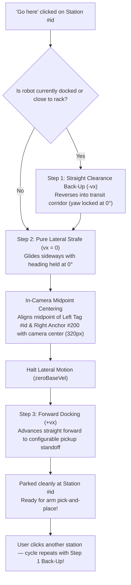

Instant Robot utilizes **Closed-Loop Visual Servoing**, **In-Camera Midpoint Centering**, and **Simultaneous Rack Exploration** along a linear station line bounded by physical 3D-printable stop stands.

---

## 3-Step Autonomous Station Docking (`Go here`)

When an operator clicks **"Go here"** on any indexed station, the robot executes a deterministic, collision-safe 3-step docking sequence:



### 1. Step 1: Straight Clearance Back-Up ("Go Behind")
- If the robot is already parked at a station ($atTag \neq null$) or is within close proximity of the rack, it first drives straight backward ($-v_x$) into the open transit corridor ($0.75\text{ m}$ standoff).
- Heading is locked strictly perpendicular to the rack ($yaw = 0^\circ$), so the robot **never turns sideways**.

### 2. Step 2: Pure Lateral Strafe & Optical Midpoint Centering
- The robot strafes laterally left or right along the transit line with $v_x = 0$ (zero forward/backward movement).
- As the target station's **Left Unique Tag (`#id`)** and **Right Anchor Tag (`#200`)** enter the camera field of view:
  - Calculates the visual center of both tags: $x_{\text{left}}$ and $x_{\text{right}}$.
  - Computes the optical midpoint:
    $$x_{\text{mid}} = \frac{x_{\text{left}} + x_{\text{right}}}{2}$$
  - Visually servos lateral velocity ($v_y = 0.9 \times \frac{x_{\text{mid}} - 320}{320}$) until the optical midpoint matches the camera optical center ($320\text{px}$, error $\le 3.5\text{px}$).
  - Once centered, the robot immediately halts all lateral motion (`zeroBaseVel()`).

### 3. Step 3: Forward Docking to Configurable Arm-Pickup Distance
- Only after the midpoint is centered with zero lateral drift, the robot advances straight forward ($+v_x = +0.20$).
- Continues forward until reaching the user-configurable pickup limit ([`settings.navWorkStandoff`](#) or tag height limit in settings).
- Halts cleanly, positioning the SO-100 arm in ideal reach of the object on the station pedestal.

---

## 3D Printable Stop Stands

The linear station rack is bounded at the start and end by **Physical Stop Stands** carrying standalone **Stop Tags (`Tag 240`)** aligned at the top of the stand.

```
       Front View                             Side Profile (Dual Gussets)
  ┌──────────────┐                         │ Taller Upright Face (centered on base)
  │   [ #240 ]   │                         │ (Tag aligned to top)
  │    [STOP]    │                       ▲ │ \ Dual Rear Isosceles Gussets
  │              │                     95mm│   \ (45°-45°-90° braces with side flanges)
  │              │                         │     \
  └──────────────┘                    ─────┴───────\───── Base Board (80mm x 80mm)
  ════════════════ (Base)             ◄────── 80mm ──────►
```

### Modular Plug-and-Play M3 System (Multi-Part Architecture)
To save print time and allow replacing individual parts if broken or modified, the stop stand can be printed as **separate modular components bolted together using standard M3 screws & nuts**:

1. **Base Plate** (`boundary_base_plate.stl`, 80 × 80 × 4 mm): Wide flat square plate with an M3 mounting hole grid (3.4 mm clearance).
2. **Clean Upright Face** (`boundary_upright_face.stl`, 52 × 3.5 × 95 mm): Holds the vertical STOP tag aligned at the top. Features 4 rear M3 mounting holes for gusset brackets.
3. **Modular Gusset Bracket with Flanges** (`boundary_gusset_bracket.stl`): 45° triangular support rib with mounting flanges extending along both non-hypotenuse sides (horizontal flange for the base, vertical flange for the upright face), each with M3 holes.
4. **Complete Stand (Monolithic)** (`boundary_stop_stand.stl`): The full all-in-one assembled 3D model.

> 📖 **Full 3D Printing Guide**: For CAD renderings, exploded assembly diagrams, slicing profiles, and assembly instructions, see the dedicated [**3D Printing Guide for Stop Stands**](/docs/hardware/3d-printing-stand/).

### 📥 3D Model Downloads & Hardware List

<div style="background: rgba(30, 41, 59, 0.7); border: 1px solid rgba(59, 130, 246, 0.4); border-radius: 8px; padding: 1.25rem; margin: 1.5rem 0;">
  <h4 style="margin-top: 0; color: #60a5fa;">Modular Multi-Part STLs (M3 Plug-and-Play)</h4>
  <p style="margin-bottom: 1rem; color: #cbd5e1;">Download the full package or individual modular components to bolt together with M3 screws:</p>
  
  <div style="margin-bottom: 1.25rem;">
    <a
      href="/models/boundary_stand_stls.zip"
      download="boundary_stand_stls.zip"
      style="display: inline-flex; align-items: center; gap: 0.5rem; background: #059669; color: #ffffff; padding: 0.6rem 1.25rem; border-radius: 6px; text-decoration: none; font-size: 0.95rem; font-weight: 600;"
    >
      📦 Download All STLs (.ZIP Bundle)
    </a>
  </div>

  <div style="display: flex; flex-wrap: wrap; gap: 0.75rem;">
    <a
      href="/models/boundary_base_plate.stl"
      download="boundary_base_plate.stl"
      style="display: inline-flex; align-items: center; gap: 0.5rem; background: #0284c7; color: #ffffff; padding: 0.5rem 1rem; border-radius: 6px; text-decoration: none; font-size: 0.88rem; font-weight: 600;"
    >
      📥 1. Base Plate (STL)
    </a>
    <a
      href="/models/boundary_upright_face.stl"
      download="boundary_upright_face.stl"
      style="display: inline-flex; align-items: center; gap: 0.5rem; background: #db2777; color: #ffffff; padding: 0.5rem 1rem; border-radius: 6px; text-decoration: none; font-size: 0.88rem; font-weight: 600;"
    >
      📥 2. Clean Upright Face (STL)
    </a>
    <a
      href="/models/boundary_gusset_bracket.stl"
      download="boundary_gusset_bracket.stl"
      style="display: inline-flex; align-items: center; gap: 0.5rem; background: #d97706; color: #ffffff; padding: 0.5rem 1rem; border-radius: 6px; text-decoration: none; font-size: 0.88rem; font-weight: 600;"
    >
      📥 3. Gusset Bracket with Flanges (STL)
    </a>
  </div>
</div>

#### Required Hardware (for Modular Assembly):
- **8× M3×8mm or M3×10mm socket head cap screws** (4× for base plate, 4× for upright face)
- **8× M3 hex nuts** (or heat-set threaded inserts)

#### Recommended 3D Print Settings:
- **Material**: PLA, PETG, or ABS
- **Layer Height**: `0.20 mm`
- **Infill**: `15% – 20%` (Grid or Gyroid)
- **Supports**: None required (each part prints flat on its largest face)

---

## Simultaneous Station Exploration (`Explore Stations`)

Instead of requiring separate passes for tag discovery and OCR inspection, Instant Robot executes **Unified Simultaneous Exploration**:

1. **Standoff Regulation**: Regulates distance to `settings.tagCameraRatio` (backing up if no tags are initially in view).
2. **3-Wheel Blended Sweep**: Glides laterally along the rack corridor with heading locked at $0^\circ$.
3. **In-Line OCR Capture**: When an unindexed station card enters view alongside Anchor 200, the robot pauses briefly ($250\text{ms}$), extracts the card via perspective homography, runs Tesseract OCR, logs the name & description live, and resumes sweeping.
4. **Boundary Reversal**: Reverses direction on the first boundary stand (`Tag 240`) and completes on the second boundary stand.
